# 🛡️ Automated SOC Home Lab: SIEM, SOAR & Incident Response Pipeline (GitHub Codespaces & PowerShell)

[[https://img.shields.io/badge/SIEM-Wazuh-0052cc?style=flat-square](https://img.shields.io/badge/SIEM-Wazuh-0052cc?style=flat-square)]
[https://img.shields.io/badge/SOAR-Shuffle-6f42c1?style=flat-square]
[https://img.shields.io/badge/Case%20Management-TheHive-cf222e?style=flat-square]
[https://img.shields.io/badge/Telemetry-Sysmon-1f6feb?style=flat-square]
[https://img.shields.io/badge/License-MIT-2da44e?style=flat-square]

## 1. Executive Summary
This project demonstrates the end-to-end architecture, deployment, and automation of a **Security Operations Center (SOC) Home Lab** hosted in **GitHub Codespaces** and administered via **Windows PowerShell**. By integrating **Wazuh** (SIEM/XDR), **Sysmon** (Endpoint Telemetry), **Shuffle** (SOAR), **VirusTotal** (Threat Intelligence), and **TheHive** (Case Management), this lab replicates a production-grade SOC detection, enrichment, and alerting pipeline.

### Key Engineering Outcomes
* **Cloud-Native Containerized SOC Infrastructure:** Deployed and networked Wazuh SIEM (`friendly space system`) and TheHive SIRP (`redesigned carnival`) across isolated GitHub Codespaces instances using controlled port forwarding.
* **PowerShell Endpoint Administration & Telemetry:** Used administrative PowerShell to verify installer hashes, deploy Sysmon64, configure Wazuh agent services, and execute controlled adversary simulations.
* **Evasion-Resistant Detection Engineering:** Engineered custom Wazuh detection rules mapped to **MITRE ATT&CK (T1003)** that detect credential-dumping tools (`Mimikatz`) via PE header metadata (`OriginalFileName`), defeating binary renaming (`trappedbaai.exe`).
* **Automated Threat Enrichment & Case Creation:** Built a SOAR playbook in Shuffle that extracts SHA-256 file hashes via Regex, enriches IOCs via VirusTotal API v3, auto-generates structured alerts in TheHive, and dispatches immediate `"Mimikatz Detected!"` email alerts to SOC analysts.

---

## 2. System Architecture & Tech Stack

### Logical Architecture & Data Flow
Because this environment runs on **GitHub Codespaces** rather than a traditional VPS behind a static perimeter firewall, inter-service communication is managed through Codespaces' encrypted **Port Forwarding** (`Private` vs. `Public` visibility controls), while endpoint configuration and adversary simulation are driven via **PowerShell**.

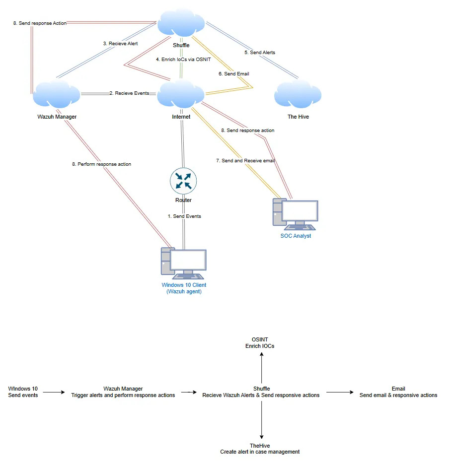

### Infrastructure & Tooling Stack

| Component | Instance / Environment | Role in SOC Pipeline | Key Ports & Access |
| :--- | :--- | :--- | :--- |
| **Wazuh SIEM & XDR** | Codespace: `friendly space system` | Central SIEM Manager, Indexer, and Dashboard | `443` (Web UI), `1514/1515` (Agent Ingestion) |
| **TheHive 5 (SIRP)** | Codespace: `redesigned carnival` | Incident Response & Case Management (Cassandra & Elasticsearch) | `9000` (Web UI & Shuffle API Endpoint) |
| **Windows 10 Pro** | Local VM (VirtualBox) | Monitored Enterprise Endpoint administered via PowerShell | Outbound telemetry to Wazuh |
| **Sysmon64** | Windows 10 Endpoint | Kernel-level process creation & hash logging (`sysmonconfig.xml`) | Local Windows Event Channel |
| **Shuffle SOAR** | Cloud SaaS (`shuffler.io`) | Automated playbook orchestration, Regex parsing & email alerting | HTTPS Webhooks & REST APIs |
| **VirusTotal** | Threat Intelligence API | Automated file hash reputation enrichment | REST API v3 (`/api/v3/files/{id}`) |

---

## 3. Implementation Walkthrough

### Phase 1: GitHub Codespaces Provisioning & Port Security
1. **Spinning Up Dedicated Codespaces:**
   * Provisioned **`friendly space system`** to host the Wazuh Manager, Indexer, and Dashboard.
   * Provisioned **`redesigned carnival`** to host TheHive 5 alongside Apache Cassandra and Elasticsearch.
2. **Access Control via Port Visibility:**
   * Managed network exposure using **GitHub Codespaces Port Forwarding** rather than a traditional firewall.
   * Forwarded Port `9000` on `redesigned carnival` so Shuffle SOAR could authenticate via API and create incident alerts, while keeping internal services restricted.

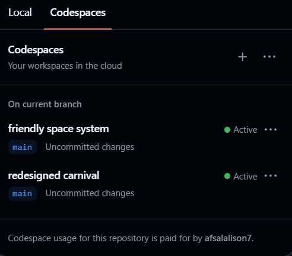

3. **PowerShell Endpoint Preparation:**
   * Opened **PowerShell as Administrator** on the Windows 10 VM to verify installer checksums (`Get-FileHash -Algorithm SHA256`), extract Sysmon archives (`Expand-Archive`), and install **Sysmon64** with a tailored configuration (`.\Sysmon64.exe -accepteula -i sysmonconfig.xml`).

---

### Phase 2: Backend Configuration & Agent Enrollment
1. **TheHive Stack Setup (`redesigned carnival`):**
   * Configured **Apache Cassandra** (`/etc/cassandra/cassandra.yaml`) with custom `cluster_name`, `listen_address`, `rpc_address`, and `seed_provider`.
   * Configured **Elasticsearch** (`/etc/elasticsearch/elasticsearch.yml`) and tuned JVM heap allocation (`-Xms2g -Xmx2g` in `/etc/elasticsearch/jvm.options.d/jvm.options`) to prevent out-of-memory crashes inside the container.
   * Updated directory ownership (`chown -R thehive:thehive /opt/thp`) and configured `/etc/thehive/application.conf`.
2. **Wazuh Agent Deployment via PowerShell (`friendly space system`):**
   * Enrolled the Windows 10 endpoint into the Wazuh Manager via administrative PowerShell (`NET START WazuhSvc` / `Restart-Service WazuhSvc`) and verified active heartbeat telemetry on the Wazuh Dashboard.

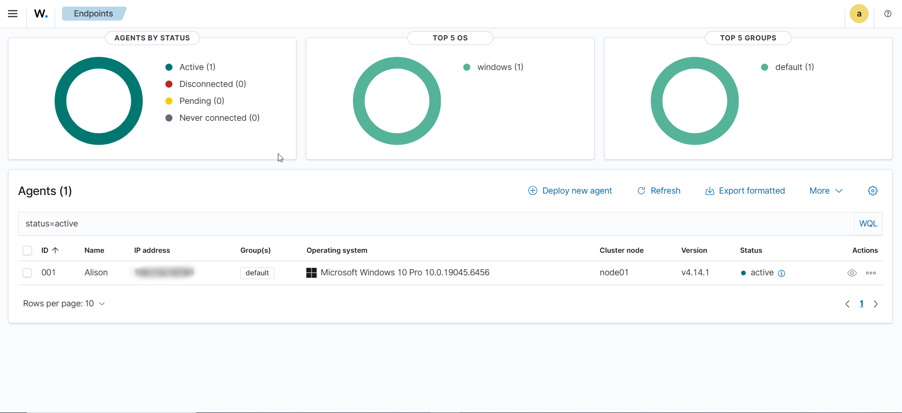

---

### Phase 3: Telemetry Ingestion & Custom Detection Engineering
1. **Sysmon Log Forwarding:** Edited `C:\Program Files (x86)\ossec-agent\ossec.conf` via administrative PowerShell to ingest the `Microsoft-Windows-Sysmon/Operational` event channel and restarted the agent (`Restart-Service WazuhSvc`).
2. **Full Log Archiving for Threat Hunting:** Enabled `<logall>` and `<logall_json>` in the Wazuh Manager (`ossec.conf`) and enabled Filebeat archiving (`archives.enabled: true`) to index raw events under `wazuh-archives-*`.
3. **PowerShell Adversary Simulation (`trappedbaai.exe`):**
   * Added a controlled folder exclusion via PowerShell (`Add-MpPreference -ExclusionPath`), executed `Mimikatz`, and queried **Sysmon Event ID 1 (Process Creation)** in Windows Event Viewer and PowerShell (`Get-WinEvent`).

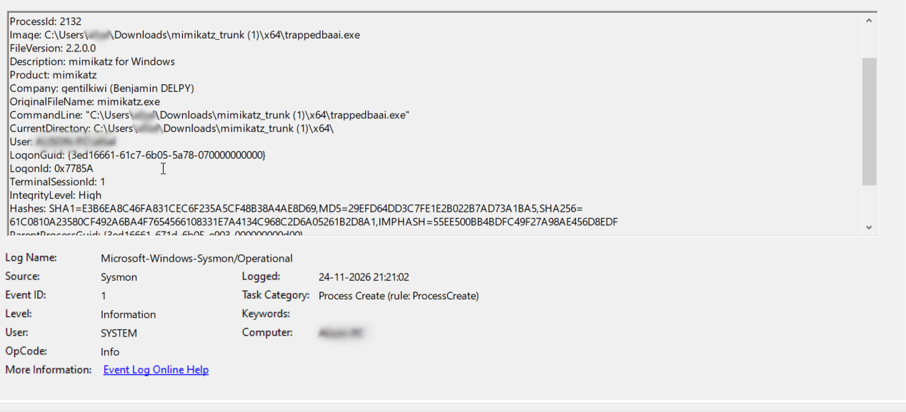

4. **Evasion-Resistant Custom Rule (`local_rules.xml`):**
   * Authored Custom Rule ID `100002` (Severity Level `15`) mapped to **MITRE ATT&CK T1003**.
   * Rather than matching on the executable filename (`Image`), which attackers easily alter, the rule inspects the internal PE header field `win.eventdata.originalFileName` for `(?i)mimikatz` and dynamically logs the original binary name in the alert description.

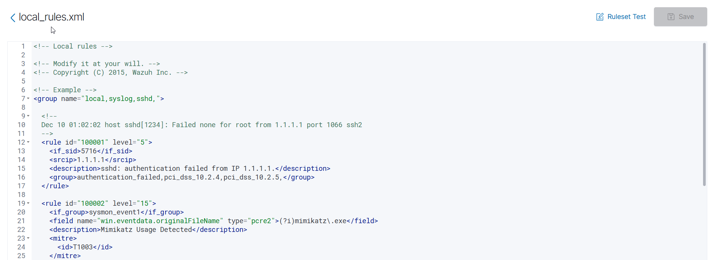

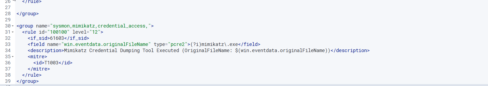

5. **Detection Validation via PowerShell:**
   * Renamed `mimikatz.exe` to **`trappedbaai.exe`** using PowerShell (`Rename-Item`) and executed `.\trappedbaai.exe`. Despite the renamed binary, Wazuh immediately triggered the Level 15 credential-dumping alert (`Rule 100002`).

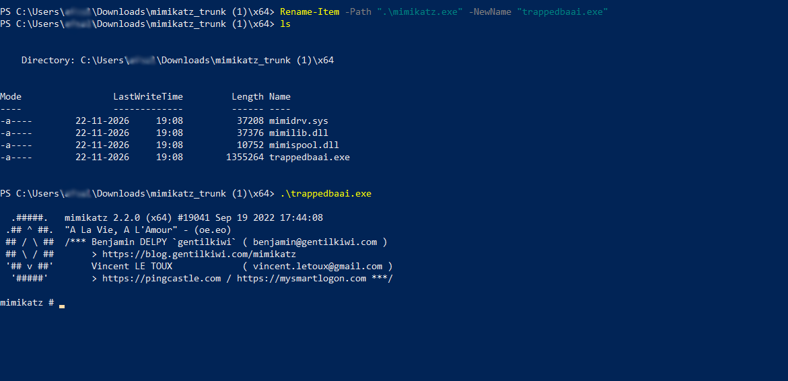

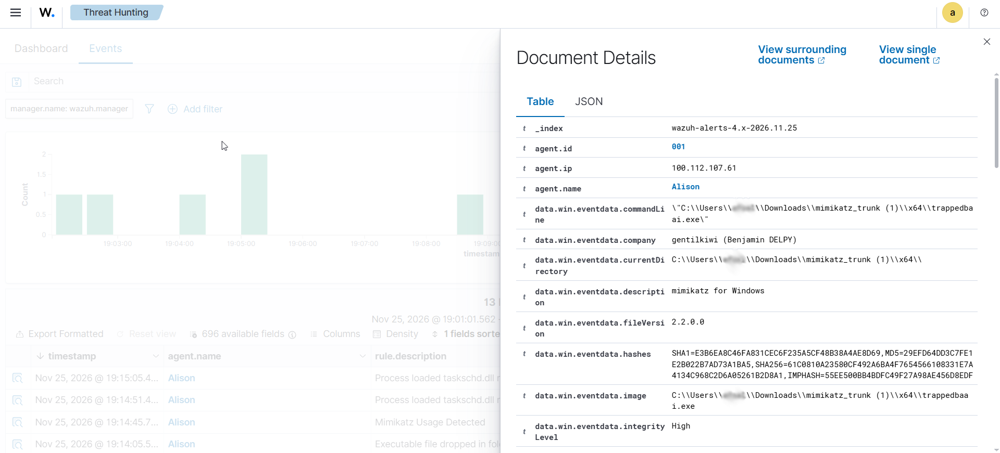

---

### Phase 4: SOAR Orchestration, Enrichment & Automated Alerting
1. **Wazuh-to-Shuffle Webhook Integration:** Configured an `<integration>` block in `friendly space system` (`ossec.conf`) to forward Rule `100002` alerts directly to a Shuffle Webhook trigger.
2. **Automated IOC Parsing & VirusTotal Enrichment:**
   * Built a Shuffle playbook that extracts the clean SHA-256 hash using a **Regex Capture Group** node.
   * Queried **VirusTotal API v3** (`/api/v3/files/{id}`) to retrieve multi-vendor threat intelligence scores (`63/71` malicious detections).

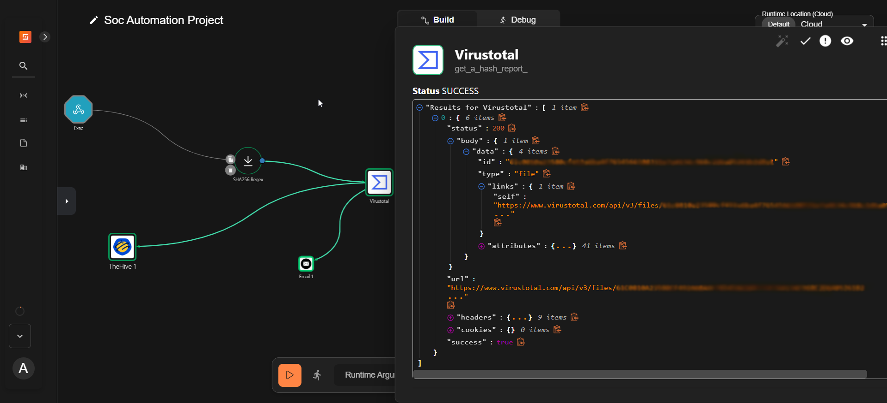

3. **Automated Case Creation in TheHive (`redesigned carnival`):**
   * Configured a dedicated `SOAR` service account in TheHive under a custom organization using least-privilege API authentication.
   * Mapped Shuffle outputs to automatically generate an actionable alert in TheHive containing UTC timestamps, hostname, user context, Process ID, command line, and MITRE tag `T1003`.

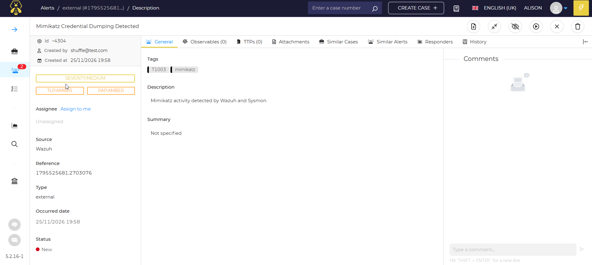

4. **Automated Analyst Email Notification:**
   * Connected Shuffle's **Email** module to automatically dispatch a high-priority `"Mimikatz Detected!"` notification containing the alert title, affected hostname, and UTC timestamp directly to the SOC analyst's inbox for immediate triage.

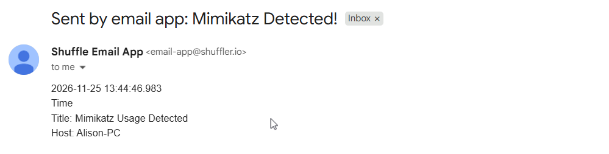

---

## 4. Engineering Challenges & Troubleshooting
* **Codespaces Ephemeral Networking & Port Exposure:** Without a traditional perimeter firewall, exposing Port `9000` via Codespaces forwarded URLs required strict credential hygiene, strong API tokens, and keeping non-API ports set to `Private`.
* **VirusTotal API v3 Endpoint Mismatch (HTTP 404):** Shuffle's built-in VirusTotal integration referenced a deprecated `/files/report` path. Resolved by **forking the app** inside Shuffle and modifying the request URI to `/api/v3/files/{id}`.
* **Elasticsearch JVM Heap Exhaustion:** Default heap sizing caused Elasticsearch to crash inside the `redesigned carnival` Codespace, blocking TheHive logins. Resolved by creating `/etc/elasticsearch/jvm.options.d/jvm.options` with `-Xms2g` and `-Xmx2g`.

---

## 5. Security & Operational Precautions
* **Isolated Lab Execution:** Adversary simulation (`trappedbaai.exe`) was strictly confined to an isolated virtual machine with no access to production networks.
* **Ephemeral Cloud Hygiene:** Because GitHub Codespaces forwarded URLs are accessible over HTTPS when set to public visibility for webhook delivery, all API keys, forwarded Codespace URLs, and email addresses have been redacted from screenshots and configuration files, and Codespaces are stopped when not actively testing.

---

## 6. Repository Structure & Artifacts
* [`configs/local_rules.xml`](configs/local_rules.xml)
* [`configs/ossec-manager-snippets.xml`](configs/ossec-manager-snippets.xml)
* [`configs/ossec-windows-agent-sysmon.xml`](configs/ossec-windows-agent-sysmon.xml)
* [`scripts/Lab-Setup-And-Verification.ps1`](scripts/Lab-Setup-And-Verification.ps1)
* [`screenshots/`](screenshots/)
